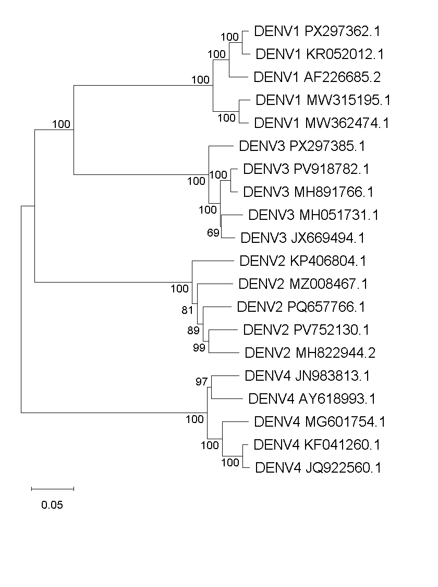
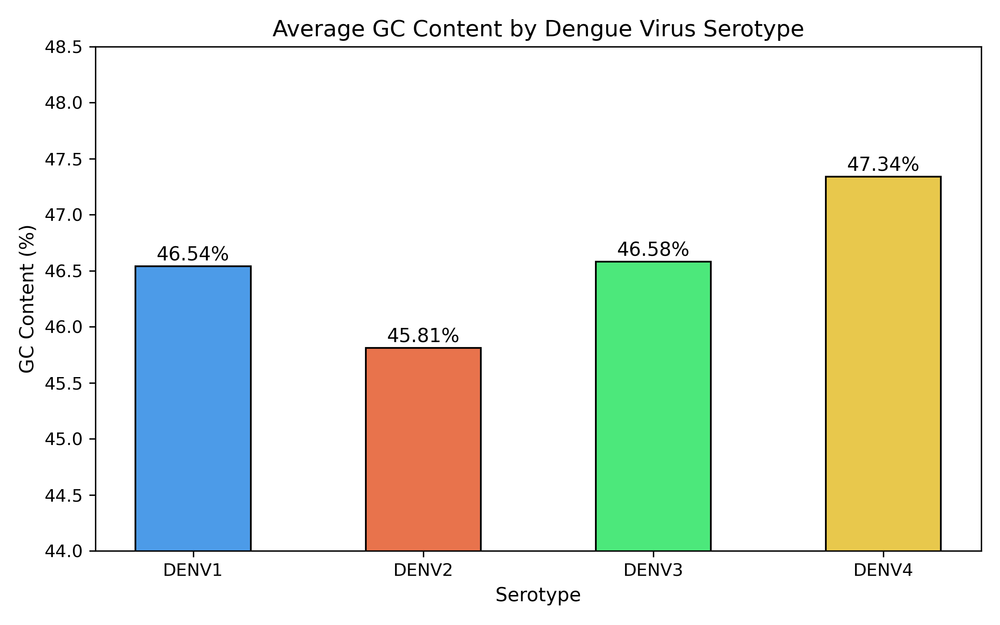

# Dengue Virus Genomic Analysis
### Comparative analysis of DENV-1 to DENV-4 complete genomes

**Author:** Gaayathri P S
**Institution:** B.Tech Biotechnology, Vellore Institute of Technology (VIT), Vellore
**Date:** June 2026

---

## Project Overview
This is an independent, beginner-level bioinformatics project comparing all four dengue virus serotypes using 20 complete genome sequences (5 per serotype) from NCBI GenBank.

Dengue is endemic in Tamil Nadu, India. Infection with one serotype does not give lasting protection against the others, and a second infection with a different serotype carries a higher risk of severe disease. This project asks how distinct the serotypes are at the genome level.

## Research Question
How genomically distinct are the four dengue virus serotypes, and can this be seen through GC content comparison and phylogenetic analysis?

---

## Key Findings
- **GC content:** Average GC content was highest in DENV-4 (47.34%) and lowest in DENV-2 (45.81%), with similar values within each serotype (n = 5 per serotype).
- **Phylogeny:** A Neighbour-Joining tree separated the 20 genomes into four clusters matching the four serotypes, each with 100% bootstrap support (1000 replicates).
- **Relationships:** DENV-1 and DENV-3 grouped most closely, and DENV-4 was the most divergent. Genomes from different countries clustered by serotype, not by location.
- **Interpretation:** The clear separation between serotypes is consistent with the lack of cross-protective immunity seen clinically.

---

## Phylogenetic Tree

*Neighbour-Joining tree, 1000 bootstrap replicates. Lower bootstrap values (69-99%) occur only within serotypes.*

## GC Content by Serotype

---

## Methods
1. **Data:** 20 complete dengue genomes (about 10,650-10,770 bp each) were downloaded from NCBI GenBank, 5 per serotype, chosen to cover different countries (including India, Thailand, Brazil, China, Bangladesh, Sri Lanka and Pakistan) and years.
2. **GC content:** Sequences were read and GC content was calculated in Python using BioPython. Results were organised with pandas and plotted with matplotlib.
3. **Alignment:** The genomes were aligned with MUSCLE in MEGA 12.
4. **Tree:** A Neighbour-Joining tree was built in MEGA 12 using Maximum Composite Likelihood distances, pairwise deletion and 1000 bootstrap replicates.

## Tools Used
| Tool | Purpose |
|------|---------|
| NCBI GenBank | Source of genome sequences |
| BioPython | Reading sequences, GC content |
| pandas, matplotlib | Data tables and charts |
| MEGA 12 | Alignment (MUSCLE) and phylogenetic tree |
| Jupyter Notebook | Analysis environment |

---

## Limitations
- Only 5 genomes per serotype were used, chosen for variety rather than at random.
- The GC content difference was not statistically tested, so it is an observed trend.
- The Neighbour-Joining tree is unrooted, so no serotype can be called ancestral.
- No sequences from Tamil Nadu were included.
- A maximum likelihood tree would be a stronger follow-up.

## Repository Contents
- `Dengue_analysis_final.ipynb`: full analysis notebook (code, results, discussion)
- `phylogenetic_tree.png`: phylogenetic tree of all 20 genomes
- `GC_content.png`: GC content chart

## About This Project
I completed this over two weeks in the summer after my first year, as a first project in bioinformatics. I learned the tools through self-guided study using online resources and AI assistance, and worked to understand and interpret each step and result myself.
